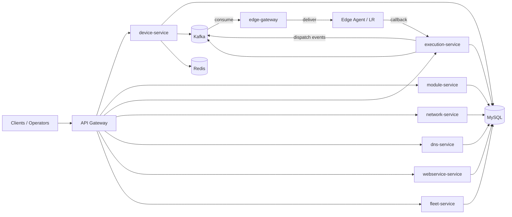
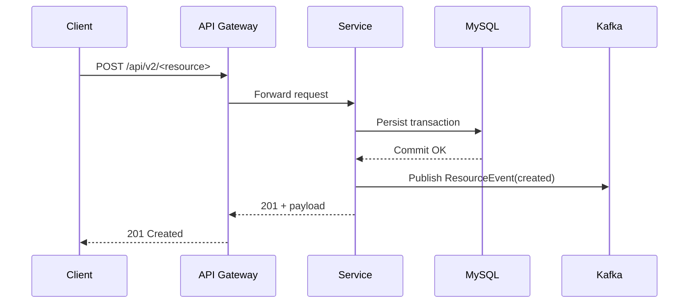

# Nexora Platform

Nexora is a cloud-native IoT control platform written as a set of small FastAPI microservices. It is a rewrite of the Stack4Things/IoTronic control plane: boards register and send heartbeats over HTTP, commands are queued in an execution service and delivered to edge agents through Kafka, and results come back through callbacks. OpenStack (Keystone/Neutron/Nova) interoperability is provided through adapters rather than hard coupling.

Status: working prototype. Per-service unit tests pass (see [Testing](#6-testing-and-verification)); the Docker/Kubernetes deployments were **not verified in this environment**.

## Contents

1. [Architecture](#1-architecture) 2. [Requirements](#2-requirements) 3. [Installation and first run](#3-installation-and-first-run) 4. [Configuration](#4-configuration) 5. [Usage end to end](#5-usage-end-to-end) 6. [Testing and verification](#6-testing-and-verification) 7. [Repository structure](#7-repository-structure) 8. [Troubleshooting](#8-troubleshooting) 9. [Limitations and security](#9-limitations-and-security) 10. [Extending Nexora](#10-extending-nexora)

## 1) Architecture



Each core service exposes `/health`, `/ready`, `/metrics` and a CRUD API under `/api/v2/...`. Writes are persisted first and then published as a `ResourceEvent` (`libraries/common/src/common/events/contracts.py`: `event_type`, `service`, `resource`, `action`, `resource_id`, `payload`, `occurred_at`).



Execution lifecycle: `queued -> dispatched -> running -> succeeded | failed | timeout`. Timeouts are enforced by `EXECUTION_DISPATCHED_TIMEOUT_SECONDS` / `EXECUTION_RUNNING_TIMEOUT_SECONDS`.

### Services and ports (docker-compose.dev.yml)

| Service | Host port | Role | API |
|---|---|---|---|
| device-service | 8000 | device inventory, agent register/heartbeat | `/api/v2/devices` |
| plugin-service (module-service) | 8001 | module metadata (legacy `/api/v2/plugins` kept) | `/api/v2/modules` |
| execution-service | 8002 | command pipeline | `/api/v2/executions` |
| network-service | 8003 | network ports | `/api/v2/ports` |
| dns-service | 8004 | DNS records | `/api/v2/dns/records` |
| webservice-service | 8005 | published endpoints | `/api/v2/webservices` |
| fleet-service | 8006 | device groups | `/api/v2/fleets` |
| lightningrod-gateway (edge-gateway) | 8007 | Kafka consumer, agent sessions, delivery | internal |
| iotronic-ui | 18088 | dashboard backend (Keycloak/Keystone login) | web UI |
| keycloak | 18080 | OIDC provider | |
| legacy-keystone / legacy-horizon | 15000 / 18089 | optional `legacy` profile | |
| mysql, redis, kafka, zookeeper | 3306, 6379, 9092, 2181 | infrastructure | |

## 2) Requirements

| Item | Version |
|---|---|
| Python | 3.11+ (`pyproject.toml` says `^3.11`; the code was exercised with 3.11) |
| Docker + Compose v2 | any recent release (needed only for the full stack) |
| Python packages | FastAPI, uvicorn, SQLAlchemy 2, alembic, pymysql, aiokafka, prometheus-client, redis, pydantic-settings, structlog (full list in the install command below) |
| kubectl, helm, k3d | only for `infrastructure/` and `scripts/kubernetes/` (not verified here) |

## 3) Installation and first run

### Option A: a single service without Docker (verified)

```bash
git clone https://github.com/lucadagati/nexora-platform.git && cd nexora-platform
python3.11 -m venv /tmp/nexora-venv && . /tmp/nexora-venv/bin/activate
pip install fastapi uvicorn prometheus-client sqlalchemy pymysql cryptography aiokafka alembic \
    pytest pytest-asyncio pytest-cov httpx redis pydantic-settings pyjwt aiosqlite greenlet \
    structlog python-json-logger email-validator aiomysql
cd services/network-service
DATABASE_URL=sqlite:///./net.db KAFKA_ENABLED=false \
PYTHONPATH=../../libraries/common/src uvicorn main:app --port 8003
```

### Option B: full stack with Docker Compose (not verified in this environment)

```bash
cp .env.example .env            # edit values first
docker compose -f docker-compose.dev.yml up -d --build
for p in 8000 8001 8002 8003 8004 8005 8006; do curl -fsS http://localhost:$p/health; done
docker compose -f docker-compose.dev.yml down -v      # clean up
```

`docker-compose.smoke.yml` and `docker-compose.test.yml` are override files and must be combined with the dev file: `docker compose -f docker-compose.dev.yml -f docker-compose.smoke.yml --env-file .env.smoke up -d`. The compose configuration itself validates with `docker compose config` (verified).

### Option C: Kubernetes

`scripts/kubernetes/setup-all.sh` provisions a k3d cluster, cert-manager, ingress, MySQL, Kafka, Redis, Keycloak, Vault, monitoring and Crossplane compositions from `infrastructure/`. Not verified in this environment.

## 4) Configuration

Environment variables read by the services (defaults from the code). Templates: `.env.example` (= `.env.dev`), `.env.smoke`, `.env.test`.

| Variable | Default | Meaning |
|---|---|---|
| `DATABASE_URL` | `sqlite:///./<service>.db` | SQLAlchemy URL (MySQL in compose) |
| `KAFKA_ENABLED` / `KAFKA_REQUIRED` | `true` / `false` | publish events / fail when Kafka is down |
| `KAFKA_BOOTSTRAP_SERVERS` | `kafka:29092` | broker address |
| `KAFKA_TOPIC_PREFIX` | `stack4things` | topic prefix |
| `KAFKA_RETRY_ATTEMPTS`, `KAFKA_RETRY_DELAY_SECONDS` | `3`, `0.5` | publish retry |
| `AUTH_ENABLED` | `false` | enforce bearer tokens |
| `AUTH_DEV_TOKEN` | `dev-token` | accepted token in dev mode |
| `AUTH_WRITE_ROLE` | `writer` | role required for writes |
| `AGENT_BOOTSTRAP_TOKENS` | `dev-bootstrap:dev-bootstrap-token:4102444800` | `id:secret:expiry_epoch`, comma separated |
| `AGENT_CALLBACK_SECRET` | empty | signs execution callbacks |
| `CALLBACK_REPLAY_REQUIRED`, `CALLBACK_REPLAY_TTL_SECONDS` | `false`, `900` | callback replay protection |
| `EXECUTION_DISPATCHED_TIMEOUT_SECONDS` / `EXECUTION_RUNNING_TIMEOUT_SECONDS` | `300` / `3600` | execution timeouts |
| `MAX_EXECUTIONS_PER_DEVICE` | `32` | per-device queue cap |
| `MAX_DELIVERY_ATTEMPTS`, `DELIVERY_BACKOFF_SECONDS` | `3`, `0.5` | gateway delivery retry |
| `REDIS_HOST`, `REDIS_PORT`, `REDIS_PASSWORD` | cluster DNS name, `6379`, empty | cache |
| `POLICY_FILE`, `POLICY_CACHE_ENABLED`, `POLICY_CACHE_TTL` | `/etc/policy/policy.json`, `true`, `3600` | RBAC policy engine |
| `KEYCLOAK_URL`, `KEYCLOAK_REALM`, `KEYCLOAK_CLIENT_ID`, `KEYCLOAK_CLIENT_SECRET`, `KEYCLOAK_ISSUER` | see `.env.dev` | OIDC login for the UI |
| `REQUEST_TIMEOUT_SECONDS`, `DB_CONNECT_TIMEOUT_SECONDS` | `5`, `5` | timeouts |
| `NEXORA_MODULES_ENABLED`, `NEXORA_DEVICE_ACCESS_ENABLED`, `NEXORA_WASM_RUNTIME_ENABLED` | see compose | UI feature flags |
| `S4T_*_URL` | `http://<service>:8000` | inter-service URLs used by the UI/gateway |

## 5) Usage end to end

Run network-service as in Option A, then (real output captured here):

```console
$ curl -s localhost:8003/health
{"status":"healthy","service":"network-service"}
$ curl -s localhost:8003/ready
{"status":"ready","service":"network-service","database":"ok"}
$ curl -s -X POST localhost:8003/api/v2/ports -H 'Content-Type: application/json' \
    -d '{"device_id":"d1","network_id":"n1"}'
{"id":"ba566061-d72c-4b64-8be1-95b8c26ba349","device_id":"d1","network_id":"n1","status":"created"}
$ curl -s localhost:8003/api/v2/ports
{"items":[{"id":"ba566061-...","device_id":"d1","network_id":"n1","status":"created"}],"total":1}
```

(The ids differ per run.) The multi-service flow (device register -> execution -> gateway -> board emulator -> callback) is driven by `scripts/lr-emulator-e2e.sh` and `scripts/integration-cross-service.sh` against the compose stack; not verified in this environment. Agent bootstrap uses the header format `<id>:<secret>` matching `AGENT_BOOTSTRAP_TOKENS`.

Dashboard backend endpoints (`services/iotronic-ui/main.py`): direct board access (`POST /api/boards/{board_id}/access-intent`, `GET /api/boards/{board_id}/access-status`, `GET /api/access/audit`), module runtime (`POST /api/modules/run`, `GET/POST/DELETE /api/modules/assignments`), Module Studio drafts, automation rules (`/api/automation/rules`) and alert rules (`/api/alerts/rules`, `/api/alerts/events`).

## 6) Testing and verification

Verified here with Python 3.11 in a throw-away venv (the root pytest config needs `pytest-cov`; the commands below bypass it):

```bash
cd services/execution-service && PYTHONPATH=../../libraries/common/src pytest -q -c /dev/null --rootdir .   # 9 passed
cd ../device-service && PYTHONPATH=../../libraries/common/src:src pytest -q -c /dev/null --rootdir . --asyncio-mode=auto   # 15 passed
cd ../network-service && PYTHONPATH=../../libraries/common/src pytest -q -c /dev/null --rootdir .   # 1 passed (same for dns, fleet, webservice)
cd ../plugin-service && PYTHONPATH=../../libraries/common/src:src pytest -q -c /dev/null --rootdir . --asyncio-mode=auto  # 2 passed
```

Also verified: every `*.py` compiles (`python3 -I -m py_compile`), every `*.sh` passes `bash -n`, compose files validate. Not verified in this environment: `scripts/test-all.sh`, `integration-cross-service.sh`, `contract-tests-api.py`, `chaos-drill.sh`, `backup-restore-validate.sh`, `perf-baseline.sh` (they need the running stack), Kubernetes/Crossplane manifests.

## 7) Repository structure

| Path | Content |
|---|---|
| `services/*-service` | FastAPI microservices (own Dockerfile, alembic migrations, `k8s/deployment.yaml`, tests) |
| `services/lightningrod-gateway`, `services/lr-board-emulator` | Kafka-to-agent gateway and a board emulator for end-to-end tests |
| `services/iotronic-ui`, `services/legacy-*` | dashboard backend and optional legacy Keystone/Horizon containers |
| `services/rbac-service` | policy engine, cache and audit modules (no Dockerfile) |
| `libraries/common` | config, DB, events (outbox, DLQ, idempotency), auth/OIDC, policy, metrics, OpenStack adapters |
| `libraries/sdk` | REST and gRPC client SDK |
| `infrastructure/` | Crossplane XRDs/compositions, Kubernetes manifests (Kafka, Keycloak, Kong, Istio, monitoring, Kyverno, Vault) |
| `tools/iotronic-ui-adapter` | Horizon plugin adapter |
| `scripts/` | setup, validation, chaos, DR, replay tooling |
| `docs/` | OpenAPI specs, ADR, runbooks, SLO/FinOps/compliance YAML |

## 8) Troubleshooting

| Symptom | Check |
|---|---|
| `pytest: unrecognized arguments: --cov` | install `pytest-cov` or pass `-c /dev/null --rootdir .` |
| `requested an async fixture` | add `--asyncio-mode=auto` |
| `No module named common` / `device_service` | set `PYTHONPATH` as shown above |
| `greenlet` / `structlog` import errors | install the full dependency list |
| Service not ready | `GET /ready` shows the database state; check `DATABASE_URL` and run `alembic upgrade head` |
| Events not published | Kafka must be reachable at `KAFKA_BOOTSTRAP_SERVERS`, or set `KAFKA_ENABLED=false` |
| Compose "no image nor build context" | smoke/test files must be combined with the dev file |
| Migration failure | `alembic current`, `alembic history`, verify credentials, downgrade one revision and retry |

## 9) Limitations and security

- Prototype: infrastructure assets (`infrastructure/`) are baselines and are not all wired into the runtime path; outbox/DLQ/idempotency primitives exist but are not wired into every write path.
- Authentication is off by default (`AUTH_ENABLED=false`); never expose that configuration.
- All passwords and tokens in compose files, `.env.*` and `scripts/kubernetes/*` (`rootpassword`, `stack4things`, `dev-token`, `dev-bootstrap-token`, `dev-root-token`, `redispassword`, UI `admin/admin`) are development defaults. Replace them for anything shared. No real secrets are committed.
- CORS defaults to `*` (`CORS_ORIGINS`).

## 10) Extending Nexora

1. Copy a small service (e.g. `services/network-service`) as a template: `main.py`, `alembic/`, `Dockerfile`, `k8s/deployment.yaml`, `tests/`.
2. Keep the `/health`, `/ready`, `/metrics` endpoints and publish a `ResourceEvent` after each write.
3. Add the service to `docker-compose.dev.yml` (and the smoke/test overrides) and to the OpenAPI specs in `docs/openapi/`.
4. Add a test next to it, run it as in section 6, and document new variables in the table above.
5. New OpenStack integrations go in `libraries/common/src/common/openstack/` as adapters.

## License

Apache License 2.0. Release and operations notes: `docs/deployment/`.
